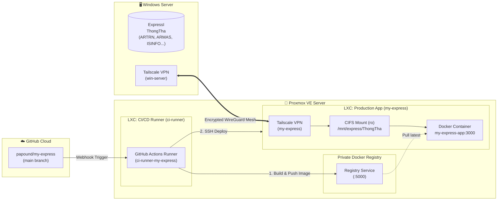

# ระบบเว็บแอปพลิเคชันบัญชี Express — บริษัท ธงธัญ99 จำกัด

เว็บแอปพลิเคชันบริหารจัดการบัญชีและการเงินแบบเรียลไทม์ เชื่อมโยงฐานข้อมูลโปรแกรม Express โดยตรง พัฒนาด้วยเทคโนโลยีทันสมัยเพื่อรองรับการใช้งานผ่าน Web Browser ทั้งบนเดสก์ท็อป แท็บเล็ต และสมาร์ทโฟน พร้อมระบบ CI/CD Deploy อัตโนมัติลงบน Proxmox VE Private Server

---

## 🚀 คุณสมบัติเด่น (Features)

1. **เชื่อมต่อฐานข้อมูล Express DBF แบบเรียลไทม์ (Live DBF Direct Access)**
   - อ่านไฟล์ DBF (Visual FoxPro) ด้วยการถอดรหัสภาษาไทย **CP874 / Windows-874** ถูกต้องแม่นยำ 100% (รวมถึงการตัดช่องว่าง Non-breaking space `0xA0`)
   - **ความปลอดภัยระดับสูงสุด**: Mount โฟลเดอร์ฐานข้อมูลจาก Windows Server ผ่าน CIFS ด้วยสิทธิ์ **Read-Only (`:ro`)** ป้องกันไฟล์ฐานข้อมูลจริงเสียหายหรือถูกเขียนทับ
   - ดึงข้อมูลบริษัทจากตารางระบบ (`ISINFO.DBF`) อัตโนมัติ: ชื่อบริษัท, ชื่อภาษาอังกฤษ, เลขประจำตัวผู้เสียภาษี, ที่อยู่สำนักงาน และเบอร์โทรศัพท์
   - แสดง **วันที่ทำการ (Working Date)** และสถานะการเชื่อมต่อฐานข้อมูลสดบน Sidebar และ Dashboard

2. **ระบบวิเคราะห์และสรุปภาพรวม (Real-time Dashboard)**
   - สรุปยอดขายรวม, ยอดขายสด (Cash), ยอดขายเชื่อ (Credit) และยอดลูกหนี้คงค้างรวม
   - สรุปจำนวนเอกสาร: ใบกำกับภาษี, ใบเสนอราคา, รอบวางบิล และจำนวนลูกค้าทั้งหมด
   - ตารางรายการขายล่าสุด (Recent Invoices) พร้อมสถานะเอกสาร
   - รายชื่อลูกหนี้การค้าค้างชำระสูงสุด 5 อันดับแรก (Top Debtors)

3. **โมดูลการทำงานครอบคลุม (Core Modules)**
   - **ใบกำกับภาษี & ใบเสร็จรับเงิน (`ARTRN.DBF`)**: ค้นหา ตรวจสอบรายการสินค้า และพิมพ์เอกสาร
   - **ใบเสนอราคา (`OESO.DBF`, `OESOIT.DBF`)**: ตรวจสอบสถานะการสั่งซื้อและรายการสินค้า
   - **ใบวางบิล (`ARBIL.DBF`, `ARBILIT.DBF`)**: ตรวจสอบรอบวางบิล วันนัดชำระเงิน และยอดคงค้าง
   - **ฐานข้อมูลลูกค้า (`ARMAS.DBF`)**: ตรวจสอบวงเงินเครดิต ที่อยู่จัดส่ง และประวัติลูกหนี้

4. **ระบบพิมพ์เอกสาร PDF สไตล์ฟอร์ม Express (PDF Report Generator)**
   - เรนเดอร์เอกสาร PDF ผ่าน Headless Chromium (Puppeteer) คมชัด สวยงาม ได้มาตรฐาน
   - ใช้ฟอนต์มาตรฐานภาษาไทย (TH Sarabun New / Noto Sans Thai)
   - แปลงจำนวนเงินเป็นตัวอักษรภาษาไทยอัตโนมัติ (BahtText เช่น *หนึ่งหมื่นสองพันบาทถ้วน*)
   - พิมพ์ใบกำกับภาษี (ต้นฉบับ/สำเนา), ใบเสร็จรับเงิน, ใบเสนอราคา และใบวางบิล

5. **ระบบรักษาความปลอดภัยและการยืนยันตัวตน (Authentication & Security)**
   - ป้องกันหน้าเว็บด้วย **NextAuth.js (JWT Session)**
   - รองรับการแบ่งสิทธิ์ผู้ใช้งาน (Administrator / User) กำหนดผ่านตัวแปร `APP_USERS`
   - รองรับการเชื่อมต่อผ่าน Tailscale VPN ปลอดภัยจากภายนอกเครือข่าย

---

## 🏗️ สถาปัตยกรรมระบบ (System Architecture)



---

## ⚙️ โครงสร้างระบบ CI/CD (GitHub Actions)

เมื่อมีการ `git push` โค้ดขึ้นมายัง Branch `main` ระบบจะรัน Pipeline อัตโนมัติผ่าน Self-Hosted Runner บน Proxmox:

- **Runner**: ติดตั้งที่ Proxmox LXC Runner (`ci-runner-my-express`)
- **Workflow File**: [`.github/workflows/deploy.yml`](.github/workflows/deploy.yml)
  - **Job 1: Build & Push**:
    - สร้าง Docker Image พร้อมแคช layer
    - Push Image ไปยัง Private Registry: `<REGISTRY_HOST>:5000/my-express/app:latest`
  - **Job 2: Deploy to Production**:
    - สั่งการผ่าน SSH ไปยัง Production Container
    - ซิงค์โค้ด Git และสงวนไฟล์คอนฟิก `.env`
    - ดึง Image ล่าสุดจาก Registry (`docker compose pull app`)
    - Restart Container อัตโนมัติ (`docker compose up -d --no-build app`)
    - ตรวจสอบสถานะการทำงานผ่าน Docker health check

---

## 📁 โครงสร้างโปรเจกต์ (Project Structure)

```text
my-express/
├── .github/
│   └── workflows/
│       └── deploy.yml          # GitHub Actions CI/CD Pipeline
├── data/
│   └── ThongTha/               # โฟลเดอร์จำลอง DBF สำหรับ Local Development
├── docker/
│   └── Dockerfile              # Multi-stage build พร้อม Chromium & Thai Fonts
├── src/
│   ├── app/                    # Next.js App Router
│   │   ├── (app)/              # Protected Route Group
│   │   │   ├── page.tsx        # Dashboard สรุปภาพรวม
│   │   │   ├── invoices/       # หน้าใบกำกับภาษี / ขาย
│   │   │   ├── quotations/     # หน้าใบเสนอราคา
│   │   │   ├── billing/        # หน้าใบวางบิล
│   │   │   └── customers/      # หน้าทะเบียนลูกค้า
│   │   ├── api/
│   │   │   ├── auth/           # NextAuth.js Authentication
│   │   │   ├── company/        # ดึงข้อมูลบริษัทจาก ISINFO.DBF
│   │   │   ├── dashboard/      # ดึงสถิติภาพรวมจาก ARTRN, OESO, ARBIL
│   │   │   └── pdf/            # Endpoints สร้าง PDF (Invoice, Quotation, Billing)
│   │   └── login/              # หน้าเข้าสู่ระบบ
│   ├── components/             # React Components (Dashboard, Layout, Shared UI)
│   │   ├── dashboard/          # DashboardView, StatCards, RecentInvoices
│   │   └── layout/             # Sidebar, Header, AppShell
│   └── lib/
│       ├── dbf/                # DBF Reader (CP874 decoder) & Table Schemas
│       └── pdf/                # Puppeteer PDF Generator & HTML Print Templates
├── docker-compose.yml          # Production Docker Compose Config
├── .env.production.example     # ไฟล์แม่แบบ Environment Variables สำหรับ Production
└── package.json
```

---

## 🔧 การตั้งค่า Environment Variables

สร้างไฟล์ `.env` บนเซิร์ฟเวอร์โดยอ้างอิงจาก `.env.production.example`:

| ตัวแปร | รายละเอียด | ตัวอย่างค่า |
|---|---|---|
| `DBF_DATA_PATH` | Path ไดเรกทอรีที่เก็บไฟล์ DBF ภายใน Container | `/data/ThongTha` |
| `NEXTAUTH_SECRET` | คีย์เข้ารหัส JWT สำหรับ Session | สุ่ม 32-64 ตัวอักษร |
| `NEXTAUTH_URL` | URL ฐานสำหรับเข้าใช้งานของระบบ | `http://<SERVER_IP>:3000` |
| `AUTH_TRUST_HOST` | อนุญาตให้ระบบเชื่อถือ Host IP ภายในวงแลน | `true` |
| `APP_USERS` | รายชื่อบัญชีผู้ใช้งานในรูปแบบ JSON Array | `[{"username":"admin","password":"...","name":"...","role":"admin"}]` |

---

## 💻 การติดตั้งและรันในเครื่อง Local (Development)

1. **Clone Repository:**
   ```bash
   git clone https://github.com/papound/my-express.git
   cd my-express
   ```

2. **ติดตั้ง Dependencies:**
   ```bash
   npm install
   ```

3. **เตรียมไฟล์ Environment:**
   ```bash
   cp .env.example .env.local
   ```

4. **รัน Development Server:**
   ```bash
   npm run dev
   ```
   เข้าใช้งานผ่านเบราว์เซอร์ที่: `http://localhost:3000`

---

## 🔑 ข้อมูลการเข้าใช้งานระบบเริ่มต้น

- **URL Production**: `http://<SERVER_IP>:3000` หรือผ่าน Tailscale IP ของเซิร์ฟเวอร์
- **บัญชีผู้ใช้งานเริ่มต้น**:
  - **ผู้ดูแลระบบ (Admin)**: `admin` / `admin1234`
  - **ผู้ใช้งานทั่วไป (User)**: `user1` / `user1234`
